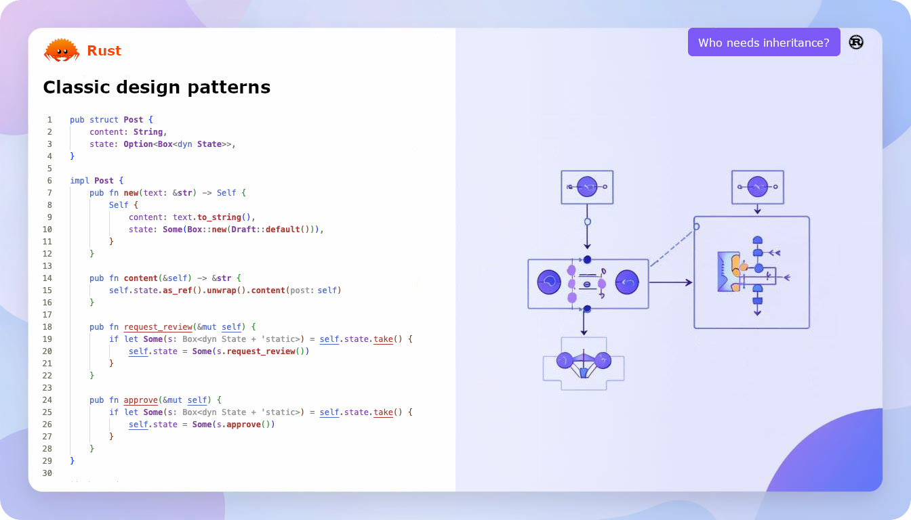

# Rust 设计模式



### Creational
* ✅ Abstract Factory
* ✅ Builder
* ✅ Factory Method
* ✅ Prototype
* ✅ Singleton

### Structural
* ✅ Adapter
* ✅ Bridge
* ✅ Composite
* ✅ Decorator
* ✅ Facade
* ✅ Flyweight
* ✅ Proxy

### Behavioral
* ✅ Chain of Responsibility
* ✅ Command
* ✅ Iterator
* ✅ Mediator
* ✅ Memento
* ✅ Observer
* ✅ State
* ✅ Strategy
* ✅ Template Method
* ✅ Visitor

### Run example

```shell
cargo run --example {patterns}
```